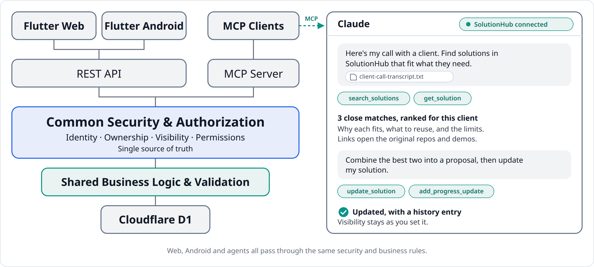

# SolutionHub

**🌐 [Open the live app: solutionhub-hrm.pages.dev](https://solutionhub-hrm.pages.dev)** · [▶ Watch the demo](#see-it-in-40-seconds) · [Connect your agent](#connect-an-mcp-client)



A GitHub-style hub to create, track, showcase and discover projects, demos and
business solutions, for people and for their AI agents.

- **Live:** https://solutionhub-hrm.pages.dev (Cloudflare Pages + D1, free plan)
- **Stack:** Flutter (web + Android) · one Cloudflare Worker (TypeScript) · D1 (SQLite)
- **Shareable URLs:** `/<username>/<solution-slug>`, like GitHub repositories
- **Contributing:** architecture, security rules and the feature checklist are in [AGENTS.md](AGENTS.md)

## See it in 40 seconds

**[▶ Watch the demo video](docs/media/solutionhub-demo.mp4)** (opens GitHub's video player)

1. Browse and create solutions in the app.
2. **Connect to agent** gives the MCP URL for Claude, ChatGPT, Claude Code and Codex.
3. Ask your agent to **discover** reusable work:

   > I'm about to build a tool that analyzes YouTube videos and suggests how to
   > improve viewer retention. Search SolutionHub for existing solutions I could
   > reuse or learn from, and summarize the top 3 with why each is relevant.

4. Or ask it to **publish** a repo as a card (private unless you say otherwise):

   > I just finished building SolutionHub, a hub where teams share projects and
   > demos, with a remote MCP server so agents can use it. The repo is
   > https://github.com/hrmiitm/solution-hub. Add it to SolutionHub as a private solution.

## Features

- **Sign-in:** Google (web and Android), verified on the server, with revocable
  sessions. Browsing public solutions needs no sign-in.
- **Visibility:** only owners edit or delete.

  | Level | Who can view |
  |---|---|
  | Public | Anyone |
  | Organization | Signed-in users on the owner's verified Google Workspace domain (`hd`). Not available to personal accounts. |
  | Private | The owner only |

  New solutions default to Organization (Workspace accounts) or Private
  (personal accounts). The API and MCP default to Private.
- **Solutions:** Markdown description, keywords (suggested from the text),
  named resource links, thumbnail, client, type, industry, function, category
  and technology.
- **Previews:** YouTube, images, Google Slides, PDFs, Markdown and text, each
  with a fallback link. Repositories, models, demos and docs show as links.
- **Lifecycle:** *Ongoing* → *Completed* → reopen or update at any time.
  Creation, edits, visibility changes, completion and progress updates appear
  in the update history. The app asks for a note when you save edits, change
  visibility or complete a solution.
- **Explore:** multi-term keyword search, filters (status and type, plus
  category, technology, industry and function via **Customize filters**) and
  numbered pages. Newest first, or **Best match** when searching.
- **Social:** like solutions and revisit them under **Liked solutions**.
  Profiles show ongoing and completed counts for what the viewer can see.
- **Remote MCP:** discovery and publishing for AI agents (see below).
- **Appearance:** System, Light or Dark, remembered per device.

## Connect an MCP client

Use **Streamable HTTP** with OAuth at `https://solutionhub-hrm.pages.dev/mcp`
(locally `http://localhost:8788/mcp`).

- **Claude:** **Customize → Connectors**, add a custom connector with the URL,
  and select **Use Claude's published identity**.
- **ChatGPT:** add the URL as a custom app and choose OAuth if prompted.
  Availability depends on your plan and workspace.
- **Claude Code / Codex:**

  ```bash
  claude mcp add --transport http solutionhub https://solutionhub-hrm.pages.dev/mcp
  codex mcp add solutionhub --url https://solutionhub-hrm.pages.dev/mcp
  codex mcp login solutionhub
  ```

  Then, in Claude Code, open `/mcp` and authenticate SolutionHub.

Sign in with Google and approve the connection. **Read** access covers what
your account can see, including private and liked solutions. **Write** access is
optional (create, edit your own cards, post progress, change status, like). To
grant it from a client that asks for read only, request both `solutions:read`
and `solutions:write` (Codex: `codex mcp login solutionhub --scopes solutions:read,solutions:write`).
Manage or revoke apps under **Connect to agent → Connected apps**.

| Tool | What it does |
|---|---|
| `search_solutions` | Search and filter visible cards, paginated |
| `get_solution` | Full Markdown description, links and optional recent history |
| `get_solution_updates` | A card's recent history |
| `get_profile` | A profile and counts (omit the username for your own) |
| `list_categories` | Filter values and counts from visible cards |
| `list_liked_solutions` | Solutions the connected account liked |
| `create_solution` | Create a card you own (private by default) |
| `update_solution` | Edit an owned card, with an optional `changeNote` |
| `add_progress_update` | Post a progress note to an owned card |
| `change_solution_status` | Complete or reopen an owned card |
| `like_solution` / `unlike_solution` | Like or unlike a visible solution |

Tools accept a solution ID, `username/slug` or a full card URL. MCP also
exposes resources (solution schema, categories, usage docs) and prompts
(discover, combine solutions against client requirements, publish a project,
update a card). Deleting is app/REST only.

- Cards hold limited context. Agents should follow the original GitHub, GitLab,
  Hugging Face, YouTube or demo links with their own permissions, and treat
  linked content as untrusted.
- The Worker requires S256 PKCE and checks audience, expiry, revocation and
  scope on every request. Tokens are stored hashed. Access tokens last one hour
  and refresh tokens rotate on use.
- Visibility and ownership use the same services as the REST API.
- Claude, ChatGPT and Codex use their published Client ID Metadata Documents.
  Other public clients can use dynamic registration (`/oauth/register`), or add
  reviewed HTTPS document URLs to `OAUTH_CLIENT_METADATA_URLS`.

## Quick start

Needs Flutter 3.47+, Node 20+, and a Cloudflare account (`npx wrangler login`).
JDK 17 and the Android SDK are needed only for the APK.

```bash
cp .env.example .env                                   # add your Google OAuth web client ID
(cd worker && npm install && npm run db:migrate:local)
scripts/dev-env.sh && node scripts/seed.mjs            # local config + sample data
scripts/build.sh web && (cd worker && npm run dev)     # http://localhost:8788
```

After Dart changes, run `scripts/build.sh web` again. After Worker-only changes,
`cd worker && npm run bundle` is enough.

## Repository layout

```
app/                 Flutter app (web + Android)
worker/src/          Worker: api.ts (REST), mcp/, oauth.ts, services/, auth/, lib/
worker/migrations/   D1 schema migrations, applied in order
worker/static/       Pages _routes.json and _headers
tests/               Backend unit and integration tests
scripts/             build, dev-env, seed (dev only), import, check-secrets
docs/media/          README video and architecture image
```

## Configuration

Copy `.env.example` to `.env` (git-ignored):

| Variable | Purpose |
|---|---|
| `GOOGLE_OAUTH_WEB_CLIENT_ID` | OAuth **Web** client ID. Used by the web button and as the audience of Android ID tokens. |
| `GOOGLE_OAUTH_ANDROID_CLIENT_ID` | Optional extra accepted audience |
| `APP_URL` | Deployed HTTPS origin the Android build talks to |

Nothing secret is compiled into the apps. Google client IDs are public.

**Google Cloud → APIs & Services → Credentials:**

1. **Web client:** add `https://solutionhub-hrm.pages.dev` and
   `http://localhost:8788` to *Authorized JavaScript origins*. No redirect URIs
   are needed.
2. **Android client:** package `com.solutionhub.app`, release SHA-1
   `4C:76:25:29:B3:A4:23:3F:FC:74:D3:4C:45:EE:69:AB:7C:69:FA:91`. Add a second
   client with the debug SHA-1 for debug builds. The app requests ID tokens for
   the web client ID.
3. Publish the consent screen, or list your testers.

## Test

```bash
cd worker && npm run typecheck && npm test   # unit tests
cd worker && npm run test:integration        # REST + MCP; needs `npm run dev` running
cd app && flutter analyze && flutter test
```

The integration suite uses throwaway users and sessions and covers
cross-account and organization isolation, CSRF, token rotation and revocation,
and REST/MCP parity. If port 8788 is busy, run `npx wrangler pages dev --port 8790`
and set `BASE_URL=http://127.0.0.1:8790`.

After deploying, check production (REST only, a few hundred requests, far below
the limits):

```bash
cd worker && BASE_URL=https://solutionhub-hrm.pages.dev D1_TARGET=remote npm run test:integration
```

To try the MCP server by hand, run `npx @modelcontextprotocol/inspector`, choose
Streamable HTTP and connect. Before login the endpoint answers HTTP 401 with
OAuth discovery information.

## Deploy

```bash
scripts/build.sh all     # worker/dist and build/solutionhub.apk
cd worker
npx wrangler d1 export solutionhub --remote --output ../backups/$(date +%F).sql   # backup before migrations (git-ignored)
npx wrangler d1 migrations apply solutionhub --remote
npx wrangler pages deploy --project-name solutionhub-hrm --branch main
```

One-time setup (done for the live deployment):

```bash
npx wrangler d1 create solutionhub                    # put the id in wrangler.jsonc
npx wrangler pages project create solutionhub-hrm --production-branch main
printf '%s' "<web-client-id>[,<android-client-id>]" | npx wrangler pages secret put GOOGLE_CLIENT_IDS --project-name solutionhub-hrm
```

### Android APK and releases

- `scripts/build.sh apk` builds `build/solutionhub.apk` pointed at `APP_URL`.
  Release signing reads `app/android/key.properties` (git-ignored), which
  points to a keystore outside the repo. Back it up: its SHA-1 is registered
  with Google, so losing it means registering a new one. Without
  `key.properties`, release builds use the debug key.
- Pushing a tag such as `v0.1.0` (or running the workflow by hand) makes
  `.github/workflows/release-android.yml` build a signed APK and attach it,
  with a SHA-256 file, to a GitHub Release. The tag must match `version:` in
  `app/pubspec.yaml`. The workflow refuses to publish if the signing SHA-1
  differs from the registered one.
- One-time setup from a machine with the keystore and `gh auth login`:
  `scripts/set-release-secrets.sh`. It stores `ANDROID_KEYSTORE_BASE64`,
  `ANDROID_KEYSTORE_PASSWORD`, `ANDROID_KEY_ALIAS` and `ANDROID_KEY_PASSWORD` as
  secrets (from `app/android/key.properties`) and `GOOGLE_OAUTH_WEB_CLIENT_ID`
  and `APP_URL` as variables (from `.env`).
- To release: raise `version:` (and the `+build` number) in `app/pubspec.yaml`,
  commit, then tag.
- App icon source: `app/web/icons/solutionhub.svg`. Regenerate the variants
  with `node scripts/generate-icons.mjs` (needs librsvg and ImageMagick).

## Initial data

`scripts/github-import/` holds the initial dataset (four users, 33 solutions
built from each repository's README, source and GitHub metadata), and
`scripts/import.mjs` loads it.

```bash
cp scripts/github-import/accounts.example.json scripts/github-import/accounts.json   # add the real owner emails (git-ignored)
node scripts/import.mjs validate
node scripts/seed.mjs                                           # local, with labelled simulated history
node scripts/import.mjs seed --target remote --confirm-production
node scripts/import.mjs status --target remote
```

- For each user the two most recently pushed repositories start *Ongoing*, the
  rest *Completed* (`ONGOING_PER_ACCOUNT` in `lib.mjs`).
- `seed` backs up to `backups/` first, removes only the old fictional demo
  data, and is idempotent, so owners' edits are never overwritten. Production
  never gets simulated history.
- Seeded users have no Google identity. The first sign-in whose verified email
  (and `hd`) matches takes the account over and fills in the name, email and
  picture from Google.
- Imports keep the repository's real dates and add an "Imported from GitHub"
  history entry. Card visibility never changes a repository's visibility.

## Rate limits

Limits are on in production, set under `vars` in `worker/wrangler.jsonc`, and
implemented once in `worker/src/lib/ratelimit.ts` for REST, MCP and OAuth.

| Scope | Default | Key | Variable |
|---|---|---|---|
| Signed-in user (web, Android, MCP combined) | 2,000 / 5 min | user | `RATE_LIMIT_USER` |
| No valid session or token | 300 / 5 min | IP | `RATE_LIMIT_ANONYMOUS` |
| Sign-in, MCP consent, OAuth register, token, revoke | 50 / 5 min | IP | `RATE_LIMIT_AUTH` |
| Whole application | 80,000 / UTC day | none | `RATE_LIMIT_GLOBAL_PER_DAY` |

- Setting a limit to `"0"` turns it off. `RATE_LIMITS_ENABLED: "false"` turns
  off the three per-client limits. `RATE_LIMIT_WINDOW_SECONDS` (default 300)
  sets the window.
- When exceeded: HTTP 429 with `Retry-After` and `error.code = "rate_limited"`.
- Per-client counters live in memory in one Worker isolate, cost no D1 reads or
  writes, and are best effort, not global. The daily budget is global (one D1
  row, flushed every 50 requests or 30 seconds) and renews at 00:00 UTC.
- Every request that runs the Worker counts toward the daily budget. Static
  Flutter files in `worker/static/_routes.json` are served by Pages without
  running the Worker.
- Local development and tests run with limits off. **Do not load-test
  production:** a spent daily budget blocks everyone until 00:00 UTC.
- Cloudflare's Rate Limiting binding is not available to Pages projects, and a
  Durable Object would need a second Worker. On `*.pages.dev` only the always-on
  DDoS mitigation applies. With a custom domain, add a WAF rate-limiting rule
  for `/api/auth/*`, `/oauth/*` and `/mcp`.
- Clients behind shared egress IPs share the per-IP limits. Raise
  `RATE_LIMIT_AUTH` if that happens.

## Known limitations

- `solutionhub.pages.dev` and `solution-hub.pages.dev` belong to other accounts,
  so the project is `solutionhub-hrm`. A custom domain must also be added to the
  OAuth origins.
- Organization membership comes from the latest verified Google sign-in. MCP
  reads the stored domain on each request. Revoke access in **Connect to agent**
  when needed.
- Search uses weighted SQL `instr()` matching, not FTS5. That is fine for
  thousands of solutions.
- Embeds depend on the remote host. Sites that forbid framing show a fallback
  link.
- Slugs stay the same when a title changes, so shared links keep working.
- Migration `0002` made every existing *public* solution *private*, because
  "public" used to mean "signed-in users only". Production had no data then.

## License

No license has been chosen yet. Until one is added, all rights are reserved and
the code is published for viewing only.
