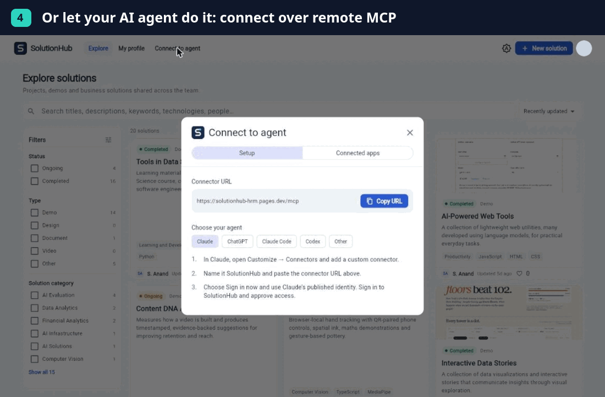

# Or let your AI agent do it: connect over remote MCP

[← Previous](03.md) · **4 / 10** · [Next →](05.md)

**Connect to agent** shows the connector URL and setup for Claude, ChatGPT, Claude Code and Codex. See [Connect an MCP client](../../README.md#connect-an-mcp-client).

[← Previous](03.md) · **4 / 10** · [Next →](05.md)
