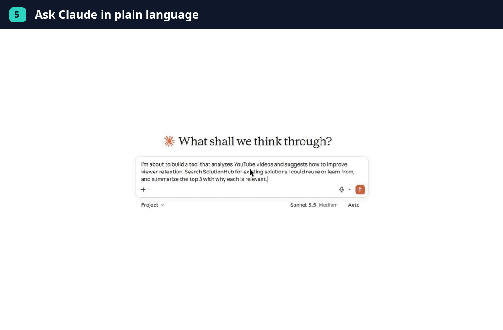

# Ask Claude in plain language

[← Previous](04.md) · **5 / 10** · [Next →](06.md)

With SolutionHub connected, describe what you are about to build:

> I'm about to build a tool that analyzes YouTube videos and suggests how to
> improve viewer retention. Search SolutionHub for existing solutions I could
> reuse or learn from, and summarize the top 3 with why each is relevant.

[← Previous](04.md) · **5 / 10** · [Next →](06.md)
