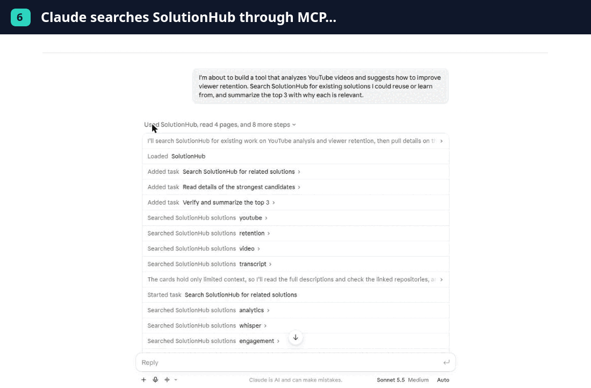

# Claude searches SolutionHub through MCP

[← Previous](05.md) · **6 / 10** · [Next →](07.md)

It runs several searches, then reads the best matches in full.

[← Previous](05.md) · **6 / 10** · [Next →](07.md)
