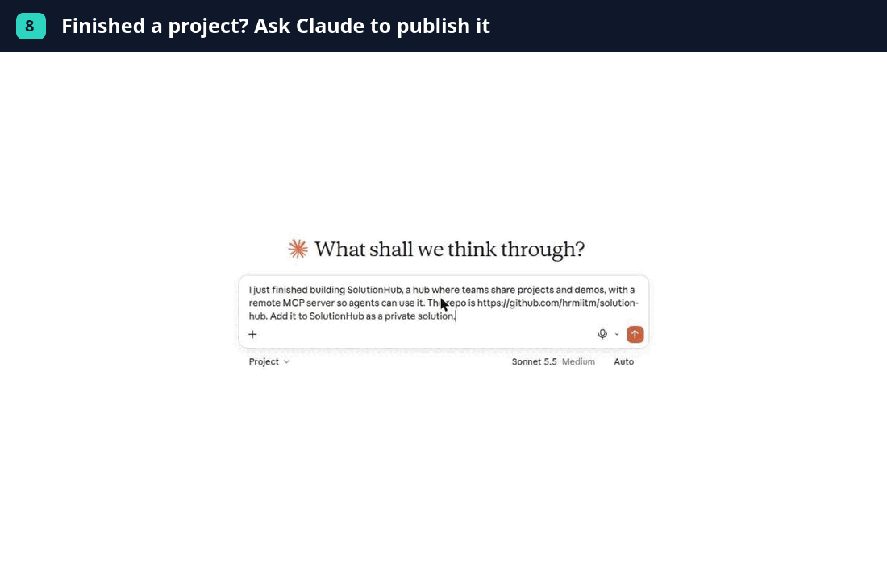

# Finished a project? Ask Claude to publish it

[← Previous](07.md) · **8 / 10** · [Next →](09.md)

Hand your agent a repository:

> I just finished building SolutionHub, a hub where teams share projects and
> demos, with a remote MCP server so agents can use it. The repo is
> https://github.com/hrmiitm/solution-hub. Add it to SolutionHub as a private solution.

[← Previous](07.md) · **8 / 10** · [Next →](09.md)
