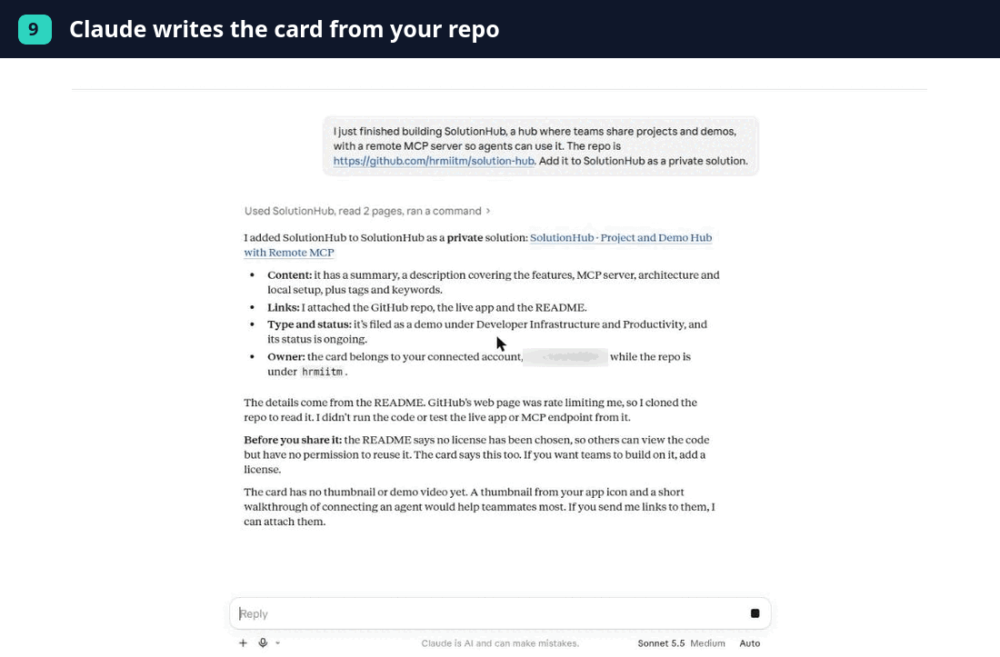

# Claude writes the card from your repo

[← Previous](08.md) · **9 / 10** · [Next →](10.md)

It reads the README, drafts the summary, description, keywords and links, and tells you what is missing (here: a licence and a thumbnail).

[← Previous](08.md) · **9 / 10** · [Next →](10.md)
