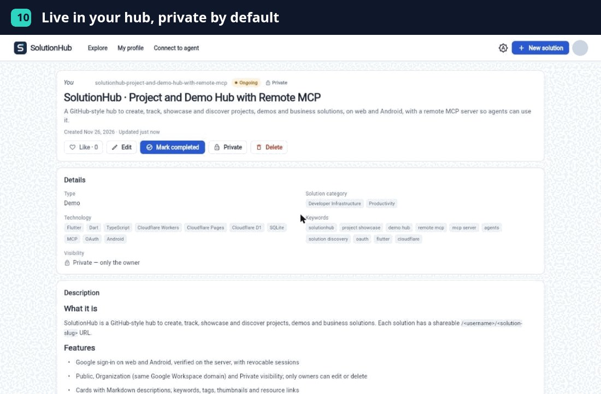

# Live in your hub, private by default

[← Previous](09.md) · **10 / 10** · [Connect your own agent →](../../README.md#connect-an-mcp-client)

Agents publish as **Private** unless you say otherwise. Change visibility, edit or complete the solution in the app.

[← Previous](09.md) · **10 / 10** · [Connect your own agent →](../../README.md#connect-an-mcp-client)
